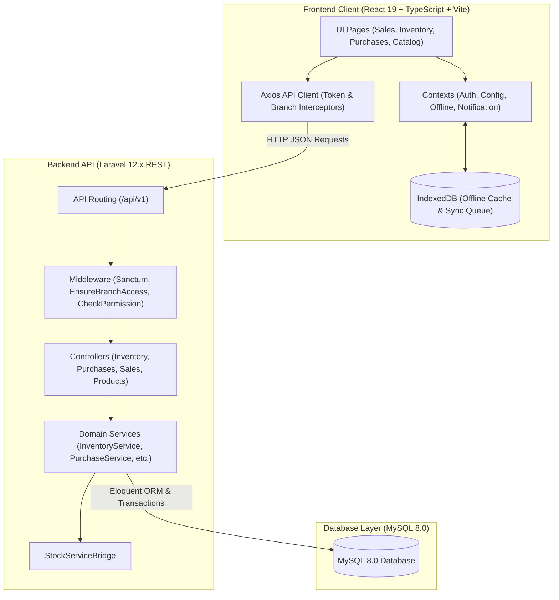
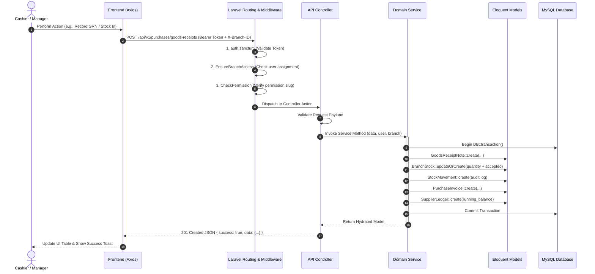
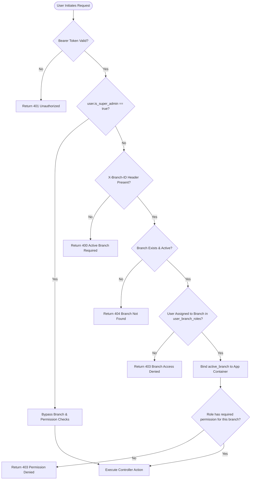
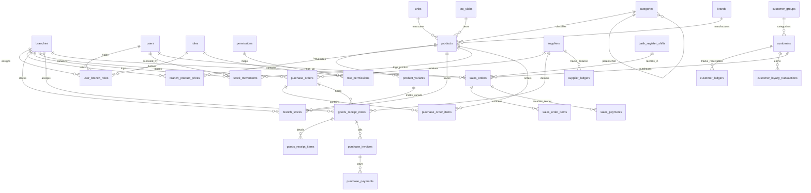
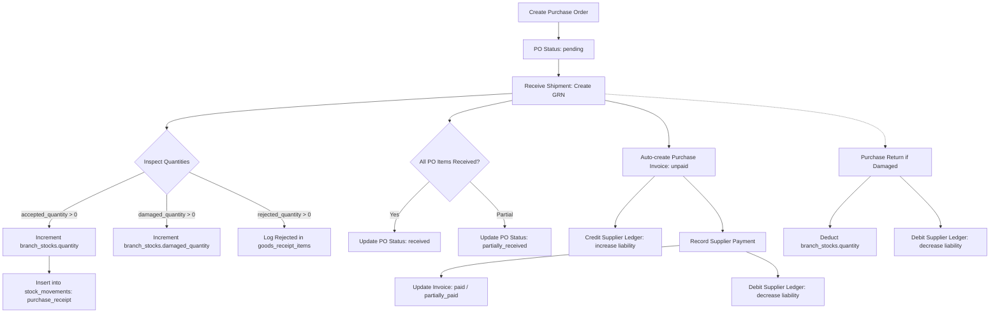

# Complete Application Architecture Audit – Reusable POS System

**Document Version:** 1.0.0
**Audit Date:** November 2, 2026
**Audited Codebase:** `c:\Users\ramya\Downloads\Reusable POS`
**Git Commit Audited:** `9f46f48` (Merge commit) / `ccabeaf` (Teammate modifications by `karthika3568`)
**Audit Objective:** Full read-only architectural verification, schema audit, recent teammate change analysis, and Phase 5 (Inventory & Stock Management) readiness assessment.

---

## 1. Executive Summary & Main Objective

The **Reusable Point of Sale (POS) System** is an enterprise-grade commercial retail and management system designed under a single-tenant deployment paradigm (one dedicated database and application instance per client, supporting multi-branch store operations). The architecture strictly rejects multi-tenant SaaS structures (no `tenant_id` or cross-tenant middleware) while providing multi-branch segmentation via `branch_id`, role-based access control (RBAC), and feature flags for business verticals (e.g., supermarket, electronics, apparel, jewellery).

A recent commit (`ccabeaf` merged via `9f46f48`) by teammate `karthika3568` added extensive code touching **101 files with 22,374 insertions**. This significantly altered the planned phase progression:
- Rather than waiting for the planned phase schedule, the teammate scaffolded migrations, models, services, controllers, and frontend pages for **Purchases (Phase 4)**, **Inventory & Stock (Phase 5)**, **POS Billing & Cash Drawer (Phase 6)**, **Customer Ledger & Loyalty (Phase 7)**, and **Offline Sync / PWA (Phase 9)**.
- While the frontend compiles cleanly (`tsc -b && vite build` succeeds with zero errors), the backend test suite has **11 test failures** due to schema collisions between the new migrations and older Phase 3 / Phase 6 test mocks, and stricter stock validation.
- Furthermore, **critical security and architectural gaps** were introduced in route protection, concurrency control, and frontend token recovery that must be resolved prior to proceeding with Phase 5.

This document presents the complete verified architecture of the application based strictly on the current source code.

---

## 2. Project Structure Analysis

The application is structured as a monorepo containing a Laravel 12 backend and a React 19 Vite frontend.

```
Reusable POS/
├── .gitignore
├── package.json                   # Monorepo orchestration scripts
├── README.md                      # Team onboarding and setup guide
├── Reusable POS documentation.md  # Original planning documentation
├── backend/                       # Laravel 12.x REST API Backend
│   ├── app/
│   │   ├── Http/
│   │   │   ├── Controllers/Api/V1/
│   │   │   ├── Middleware/
│   │   │   └── Requests/
│   │   ├── Models/
│   │   ├── Providers/
│   │   ├── Services/
│   │   └── Traits/
│   ├── bootstrap/
│   ├── config/
│   ├── database/
│   │   ├── migrations/
│   │   ├── seeders/
│   │   └── reusable_pos_schema_and_data.sql
│   ├── routes/
│   └── tests/
└── frontend/                      # React 19 + TypeScript + Vite Frontend
    ├── public/
    ├── src/
    │   ├── api/
    │   ├── components/
    │   ├── config/
    │   ├── context/
    │   ├── hooks/
    │   ├── modules/
    │   ├── pages/
    │   ├── routes/
    │   ├── services/
    │   ├── styles/
    │   ├── types/
    │   └── utils/
    ├── package.json
    ├── tsconfig.json
    └── vite.config.ts
```

---

### 2.1 Backend Project Structure (Laravel 12)

#### `backend/app/Http/Controllers/Api/V1/`
Houses API controllers handling incoming HTTP requests, delegating to domain services, and returning formatted JSON responses:
- `AuthController.php`: Handles login (email/password and POS PIN), authenticated user profile (`/me`), and logout session termination.
- `BranchController.php`: Provides branch listing for the current user and retrieves the active branch context.
- `BrandController.php`: Full CRUD operations for product brands.
- `CategoryController.php`: Category listing (flat and tree structures) and CRUD.
- `UnitController.php`: Units of measurement listing and CRUD.
- `ProductController.php`: Product catalog querying, variant handling, barcode lookup, branch pricing overrides, barcode generation, bulk import/export.
- `CustomerController.php`: Customer master CRUD, status toggle, code generation, credit payments, customer groups, and bulk import/export.
- `SupplierController.php`: Supplier directory CRUD, status toggle, and code generation.
- `InventoryController.php`: Stock queries, direct stock in/out, reason-based stock adjustments, inter-branch stock transfers, valuation reports, and batch tracking.
- `PurchaseController.php`: Purchase order CRUD, goods receipt notes (GRN), purchase invoices, vendor payments, purchase returns, and supplier ledger statement generation.
- `SaleController.php`: Counter sales transactions, invoice retrieval, and branch sales summaries.
- `CashRegisterController.php`: Cashier shift opening, closing, drawer reconciliation, and cash in/out movements.
- `SettingsController.php`: Business profile, feature flags, tax slabs, system users, role permission assignments, app key-value settings, and system health status.
- `SyncController.php`: Offline data pull (catalog/customers), offline transaction batch push with idempotency checking, and connection heartbeat status.

#### `backend/app/Models/`
Contains 40 Eloquent models defining database tables, relationships, attribute casting, and local query scopes. Notable models include:
- `BranchStock.php`: Tracks current quantity, damaged quantity, and reserved quantity per branch, product, and variant.
- `StockMovement.php`: Immutable audit ledger recording every inventory addition, deduction, transfer, return, and sale.
- `StockAdjustment.php` & `StockAdjustmentItem.php`: Header and item records for manual inventory reconciliations.
- `StockTransfer.php` & `StockTransferItem.php`: Inter-branch stock transfer dispatch and receipt tracking.
- `PurchaseOrder.php` & `PurchaseOrderItem.php`: Procurement order tracking with line items.
- `GoodsReceiptNote.php` & `GoodsReceiptItem.php`: Physical goods receipt tracking accepted, damaged, and rejected quantities.
- `SalesOrder.php`, `SalesOrderItem.php`, `SalesPayment.php`: Point of sale transactions, line items with GST tax breakdown, and split payment methods.
- `CustomerLedger.php` & `SupplierLedger.php`: Running balance audit ledgers for receivables and payables.

#### `backend/app/Services/`
Encapsulates all business logic, transaction boundaries (`DB::transaction`), and cross-model workflows:
- `Auth/AuthService.php`: Sanctum token issuance, PIN hashing, user profile compilation.
- `Customers/CustomerService.php`: Customer codes, ledger entries, credit limit validation, group discounts.
- `Suppliers/SupplierService.php`: Vendor directory and deletion safeguards.
- `Products/ProductService.php`: Variant attribute fingerprinting, branch pricing resolution, audit logging.
- `Inventory/InventoryService.php`: Stock in/out calculations, adjustment processing, inter-branch transfer state transitions, stock valuation algorithms.
- `Inventory/StockServiceBridge.php`: Implements `StockServiceInterface` to decouple Sales from Inventory, validating stock availability and deducting inventory on sale checkout.
- `Purchases/PurchaseService.php`: PO creation, GRN processing with accepted-only stock increments, auto-generation of Purchase Invoices and Supplier Ledger entries, payment recording, and purchase returns.
- `Sales/SalesService.php`: Invoice number generation (`INV-{BRANCH}-{YYYYMMDD}-{SEQ}`), GST calculation, item discounting, stock deduction triggering, cash register linking.
- `Sales/CashRegisterService.php`: Shift lifecycle, cash movement tracking, expected closing balance calculations.

#### `backend/app/Http/Requests/`
Form request classes enforcing request validation rules:
- `Auth/LoginRequest.php`: Validates email/password or PIN.
- `Products/StoreProductRequest.php`, `UpdateProductRequest.php`, `SetBranchPriceRequest.php`, `StoreCategoryRequest.php`, `StoreUnitRequest.php`.
- `Customers/StoreCustomerRequest.php`, `UpdateCustomerRequest.php`.
- `Suppliers/StoreSupplierRequest.php`, `UpdateSupplierRequest.php`.
- `Sales/StoreSaleRequest.php`, `OpenShiftRequest.php`, `CloseShiftRequest.php`, `RecordCashMovementRequest.php`.

*(Note: `InventoryController` and `PurchaseController` currently use inline `$request->validate([...])` rather than dedicated Form Requests).*

#### `backend/app/Http/Middleware/`
- `EnsureBranchAccess.php` (aliased as `branch.access`): Inspects `X-Branch-ID` header, verifies branch existence and user authorization via `canAccessBranch()`, and binds `active_branch` into Laravel's IoC container.
- `CheckPermission.php` (aliased as `permission`): Enforces RBAC permissions per branch or globally. Bypasses checks for `is_super_admin`.
- `CheckFeatureFlag.php` (aliased as `feature`): Checks vertical feature flag enablement in `business_features`.

#### `backend/app/Traits/ApiResponse.php`
Enforces standard API response structures:
- `successResponse($data, $message, $code, $meta)`
- `paginatedResponse(LengthAwarePaginator $paginator, $message, $code)`
- `errorResponse($message, $code, $errors, $errorCode)`

#### `backend/app/Models/AuditLog.php`
Provides an audit log storing user ID, branch ID, action name, auditable model class and ID, old JSON values, new JSON values, and IP address.

---

### 2.2 Frontend Project Structure (React 19 + TypeScript)

#### `frontend/src/api/`
- `client.ts`: Axios instance configured with base URL, timeout (15s), request interceptors attaching `Authorization: Bearer <token>` and `X-Branch-ID`, and a response interceptor handling 401 token refresh.
- `endpoints.ts`: Central dictionary of all API endpoint routes grouped by module (`auth`, `settings`, `branches`, `brands`, `categories`, `units`, `products`, `sales`, `cashRegisters`, `inventory`, `purchases`, `customers`, `suppliers`, `sync`).

#### `frontend/src/context/`
- `AuthContext.tsx`: Manages user authentication, token persistence, role state, login via password or PIN, and demo role switching. Includes auto-initialization session logic.
- `ConfigContext.tsx`: Manages active business vertical (e.g. `supermarket`, `electronics`), active store branding, and feature flag checks (`isFeatureEnabled`).
- `OfflineContext.tsx`: Tracks online/offline status, simulated offline toggle, pending transaction queue, sync logs, and triggers background synchronization with IndexedDB.
- `NotificationContext.tsx`: Manages global toast alerts (success, error, warning, info).

#### `frontend/src/services/`
Domain API services consuming `apiClient`:
- `productService.ts`, `customerService.ts`, `supplierService.ts`, `inventoryService.ts`, `purchaseService.ts`, `salesService.ts`, `cashRegisterService.ts`, `settingsService.ts`, `syncService.ts`.
- `offlineDb.ts`: Custom browser IndexedDB wrapper using raw `indexedDB` API with object stores: `products`, `customers`, `categories`, `units`, `tax_slabs`, `pending_transactions`, `sync_logs`, `meta`.

#### `frontend/src/pages/`
Top-level page views rendered in `AppRoutes.tsx`:
- `DashboardPage.tsx`: Executive KPI cards, sales overview chart, payment breakdown chart, profit & loss summary, low stock table, recent sales table.
- `SalesPage.tsx`: Full counter POS interface (catalog grid, barcode scanner, cart line item discounts, tax calculation, split payments cash/UPI/card, receipt modal), sales history, cashier shifts.
- `ProductsPage.tsx`: Catalog management, barcode generation, branch pricing overrides, brand management, category tree, unit definitions.
- `CustomersPage.tsx`: Customer directory, credit management, customer groups, ledger statements, loyalty history.
- `SuppliersPage.tsx`: Supplier vendor directory, contact cards, status toggles.
- `InventoryPage.tsx`: Inventory dashboard, branch stock overview, stock in/out forms, reason-based adjustment modal, inter-branch transfer creation & receiving, movement audit history, batch/expiry management, stock valuation report.
- `PurchasesPage.tsx`: Purchase orders, goods receipt notes (GRN), vendor invoices, payment recording, purchase returns, supplier ledger reports.
- `SettingsPage.tsx`: Store profile, tax slabs, system users, roles & permissions matrix, printer configuration, barcode settings, offline sync settings, system health diagnostics.
- `ModulePlaceholder.tsx`: Fallback component for modules not yet standalone (Finance, Reports).

#### `frontend/src/components/common/`
Reusable UI component library:
`Button`, `Input`, `Select`, `Card`, `Badge`, `Modal`, `ConfirmDialog`, `Table`, `Pagination`, `SearchInput`, `DatePicker`, `EmptyState`, `LoadingState`, `Notification`, `SyncCenterModal`.

---

## 3. Technology Stack Verification

The following versions have been verified directly from `composer.json`, `composer.lock`, `package.json`, and runtime commands:

| Component | Target Requirement | Actual Installed Version | Verification Source |
|---|---|---|---|
| **PHP** | `^8.2` | `8.2.12 (cli) ZTS MSVC 2019 x64` | `php -v` |
| **Laravel Framework** | `^12.0` | `v12.70.2` | `backend/composer.lock` |
| **Laravel Sanctum** | `^4.0` | `v4.3.3` | `backend/composer.lock` |
| **PHPUnit** | `^11.5.50` | `11.5.50` | `backend/composer.lock` |
| **Database Server** | MySQL 8.0+ | `MySQL Community Server 8.0.43 (Win64)` | `mysql --version` |
| **Node.js** | `>=18.0.0` | `v22.19.0` | `node -v` |
| **npm** | `>=10.0.0` | `10.9.3` | `npm -v` |
| **React** | `^19.3.1` | `19.3.1` | `frontend/package-lock.json` |
| **React-DOM** | `^19.3.1` | `19.3.1` | `frontend/package-lock.json` |
| **TypeScript** | `~7.0.2` | `7.0.2` | `frontend/package-lock.json` |
| **Vite** | `^8.3.5` | `8.3.5` | `frontend/package-lock.json` |
| **Tailwind CSS** | `^4.3.3` | `4.3.3` (with `@tailwindcss/vite` 4.3.3) | `frontend/package-lock.json` |
| **TanStack React Query** | `^5.105.0` | `5.105.0` | `frontend/package-lock.json` |
| **Axios** | `^1.21.0` | `1.21.0` | `frontend/package-lock.json` |
| **React Router DOM** | `^7.18.5` | `7.18.5` | `frontend/package-lock.json` |
| **Recharts** | `^3.10.1` | `3.10.1` | `frontend/package-lock.json` |
| **Lucide React** | `^1.64.0` | `1.64.0` | `frontend/package-lock.json` |
| **Oxlint** | `^1.89.0` | `1.89.0` | `frontend/package-lock.json` |

---

## 4. Complete Database Architecture

The application database schema consists of **53 tables** created via 27 database migration files and recorded in `backend/database/reusable_pos_schema_and_data.sql`.

Below is the verified inventory of all tables, organized into their 15 functional modules:

---

### Module 1: Authentication and User Management
1. **`users`**
   - **Purpose:** Stores user authentication identities and global super admin privileges.
   - **Key Columns:** `id`, `name`, `email` (unique), `password` (hashed), `pin_code` (hashed, nullable), `is_super_admin` (bool, default false), `is_active` (bool, default true), `last_login_at`, `timestamps`.
   - **Soft Delete:** No.
   - **Indexes:** Primary key `id`, unique index on `email`.
2. **`password_reset_tokens`**
   - **Purpose:** Password reset tokens.
   - **Key Columns:** `email` (primary key), `token`, `created_at`.
3. **`personal_access_tokens`**
   - **Purpose:** Laravel Sanctum API tokens.
   - **Key Columns:** `id`, `tokenable_type`, `tokenable_id`, `name`, `token` (unique), `abilities`, `last_used_at`, `expires_at`, `timestamps`.
4. **`sessions`**
   - **Purpose:** Session storage for web requests.
   - **Key Columns:** `id` (primary key), `user_id`, `ip_address`, `user_agent`, `payload`, `last_activity`.

---

### Module 2: Roles and Permissions
5. **`roles`**
   - **Purpose:** Named operational roles (e.g. Administrator, Branch Manager, Cashier, Inventory Clerk).
   - **Key Columns:** `id`, `name`, `slug` (unique), `description`, `is_system` (bool), `timestamps`.
6. **`permissions`**
   - **Purpose:** Granular action authorizations (e.g. `pos.billing`, `catalog.manage`, `inventory.adjust`).
   - **Key Columns:** `id`, `slug` (unique), `module`, `description`, `timestamps`.
   - **Indexes:** `module`.
7. **`role_permissions`**
   - **Purpose:** Many-to-many pivot mapping roles to permissions.
   - **Key Columns:** `role_id` (FK -> `roles.id`), `permission_id` (FK -> `permissions.id`).
   - **Primary Key:** Composite `(role_id, permission_id)`.
8. **`user_branch_roles`**
   - **Purpose:** Maps users to roles *within specific branches*. Enables different roles per branch.
   - **Key Columns:** `id`, `user_id` (FK -> `users.id`), `branch_id` (FK -> `branches.id`), `role_id` (FK -> `roles.id`), `timestamps`.
   - **Unique Constraints:** `uq_user_branch_role` on `(user_id, branch_id, role_id)`.
   - **Indexes:** `(user_id, branch_id)`.

---

### Module 3: Business Profile and Configuration
9. **`business_profiles`**
   - **Purpose:** Enterprise identity, legal details, tax number, currency, and vertical classification.
   - **Key Columns:** `id`, `business_name`, `legal_name`, `tax_id` (GSTIN), `currency_code` (INR), `currency_symbol` (₹), `timezone`, `active_vertical`, `email`, `phone`, `address`, `timestamps`.
10. **`business_features`**
    - **Purpose:** Modular feature flags for business verticals.
    - **Key Columns:** `id`, `feature_key` (unique), `is_enabled` (bool), `config_payload` (JSON), `timestamps`.
11. **`tax_slabs`**
    - **Purpose:** Indian GST and regional tax rates with split CGST/SGST/IGST breakdown.
    - **Key Columns:** `id`, `name`, `rate` (5,2), `cgst_rate` (5,2), `sgst_rate` (5,2), `igst_rate` (5,2), `is_active` (bool), `timestamps`.
12. **`app_settings`**
    - **Purpose:** Dynamic key-value configuration grouped by domain (`general`, `invoice`, `printer`, `barcode`, `sync`).
    - **Key Columns:** `id`, `group`, `key` (unique), `value` (longtext), `type` (string), `description`, `timestamps`.
    - **Indexes:** `group`, `key`.
13. **`audit_logs`**
    - **Purpose:** Centralized transactional audit log for system modifications.
    - **Key Columns:** `id`, `user_id` (nullable FK), `branch_id` (nullable FK), `action`, `auditable_type`, `auditable_id`, `old_values` (JSON), `new_values` (JSON), `ip_address`, `created_at`.
    - **Indexes:** `(auditable_type, auditable_id)`, `created_at`.

---

### Module 4: Branch Management
14. **`branches`**
    - **Purpose:** Multi-branch store locations within the client installation.
    - **Key Columns:** `id`, `branch_code` (unique), `name`, `location`, `address`, `phone`, `email`, `is_main_branch` (bool), `is_active` (bool), `timestamps`.
    - **Indexes:** `is_active`.

---

### Module 5: Product Categories
15. **`categories`**
    - **Purpose:** Hierarchical product categories supporting self-referential parent-child nesting.
    - **Key Columns:** `id`, `parent_id` (nullable self FK -> `categories.id` ON DELETE SET NULL), `name`, `slug` (unique), `description`, `image_url`, `is_active` (bool), `timestamps`.
    - **Indexes:** `(parent_id, is_active)`.

---

### Module 6: Units of Measurement
16. **`units`**
    - **Purpose:** Units of measurement with explicit decimal quantity support flag.
    - **Key Columns:** `id`, `name`, `short_code` (unique, e.g. `pcs`, `kg`, `ltr`), `allow_decimals` (bool, default false), `timestamps`.

---

### Module 7: Products & Brands
17. **`brands`**
    - **Purpose:** Product brand manufacturer master.
    - **Key Columns:** `id`, `name`, `code` (unique, nullable), `description`, `logo_url`, `is_active` (bool), `timestamps`.
    - **Indexes:** `name`, `is_active`.
18. **`products`**
    - **Purpose:** Master product catalog records.
    - **Key Columns:** `id`, `category_id` (FK -> `categories.id` RESTRICT), `brand_id` (nullable FK -> `brands.id` SET NULL), `unit_id` (FK -> `units.id` RESTRICT), `tax_slab_id` (nullable FK -> `tax_slabs.id` SET NULL), `name`, `sku` (unique), `barcode` (unique, nullable), `hsn_code`, `tax_rate` (5,2), `is_tax_inclusive` (bool), `cost_price` (12,2), `selling_price` (12,2), `mrp` (12,2), `minimum_stock` (10,3), `has_variants` (bool), `is_active` (bool), `description`, `image_url`, `metadata` (JSON), `timestamps`, `deleted_at`.
    - **Soft Delete:** Yes (`SoftDeletes`).
    - **Indexes:** Unique `sku`, unique `barcode`, index on `category_id`, `brand_id`, `unit_id`, `is_active`.

---

### Module 8: Product Variants
19. **`product_variants`**
    - **Purpose:** SKU variants for products with attributes (size, colour, style).
    - **Key Columns:** `id`, `product_id` (FK -> `products.id` CASCADE), `variant_sku` (unique), `variant_barcode` (unique, nullable), `attributes_json` (JSON), `attribute_fingerprint` (varchar 64, sha256 hash), `cost_price` (12,2), `selling_price` (12,2), `is_active` (bool), `timestamps`.
    - **Unique Constraints:** Unique on `variant_sku`, unique on `variant_barcode`, unique composite `(product_id, attribute_fingerprint)`.
    - **Indexes:** `(product_id, is_active)`, `variant_barcode`.

---

### Module 9: Branch Product Pricing
20. **`branch_product_prices`**
    - **Purpose:** Branch-level selling and promotional price overrides.
    - **Key Columns:** `id`, `branch_id` (FK -> `branches.id` CASCADE), `product_id` (FK -> `products.id` CASCADE), `variant_id` (nullable FK -> `product_variants.id` RESTRICT), `variant_key` (generated virtual column: `COALESCE(variant_id, 0)`), `selling_price` (12,2), `special_price` (12,2, nullable), `is_active` (bool), `timestamps`.
    - **Unique Constraints:** `uq_branch_product_variant_price` on `(branch_id, product_id, variant_key)`.
    - **Indexes:** `(branch_id, is_active)`.

---

### Module 10: Customers Master & Enhancements
21. **`customer_groups`**
    - **Purpose:** Customer classification tiers (Retail, Wholesale, VIP, Corporate).
    - **Key Columns:** `id`, `name`, `code` (unique), `discount_percentage` (5,2), `credit_limit` (12,2), `description`, `is_active` (bool), `timestamps`.
    - **Indexes:** `code`, `is_active`.
22. **`customers`**
    - **Purpose:** Customer profiles, addresses, tax registration, credit and loyalty points.
    - **Key Columns:** `id`, `customer_code` (unique), `customer_group_id` (nullable FK -> `customer_groups.id` SET NULL), `customer_type` (retail/wholesale/vip), `name`, `phone`, `alternate_phone`, `email`, `address`, `city`, `state`, `postal_code`, `tax_number` (GSTIN), `credit_limit` (12,2), `opening_balance` (12,2), `current_balance` (12,2), `loyalty_points` (integer), `notes`, `is_active` (bool), `timestamps`, `deleted_at`.
    - **Soft Delete:** Yes (`SoftDeletes`).
    - **Indexes:** `customer_code`, `name`, `phone`, `is_active`.
23. **`customer_ledgers`**
    - **Purpose:** Financial receivable running balance audit ledger per customer.
    - **Key Columns:** `id`, `customer_id` (FK -> `customers.id` CASCADE), `branch_id` (nullable FK -> `branches.id` SET NULL), `transaction_type` (`opening_balance`, `sale`, `payment`, `return`, `credit_adjustment`), `reference_type` (string), `reference_id` (bigint), `transaction_date` (date), `debit` (14,2, sale/receivable increase), `credit` (14,2, payment/return decrease), `running_balance` (14,2), `notes`, `timestamps`.
    - **Indexes:** `customer_id`, `transaction_date`.
24. **`customer_loyalty_transactions`**
    - **Purpose:** Points reward and redemption transactions.
    - **Key Columns:** `id`, `customer_id` (FK -> `customers.id` CASCADE), `sales_order_id` (nullable FK -> `sales_orders.id` SET NULL), `type` (`earned`, `redeemed`, `expired`, `adjustment`), `points` (int), `conversion_amount` (10,2), `notes`, `timestamps`.
    - **Indexes:** `customer_id`.

---

### Module 11: Suppliers Master & Ledger
25. **`suppliers`**
    - **Purpose:** Vendor directory and procurement contact profiles.
    - **Key Columns:** `id`, `supplier_code` (unique), `name`, `contact_person`, `phone`, `alternate_phone`, `email`, `address`, `city`, `state`, `postal_code`, `tax_number`, `notes`, `is_active` (bool), `timestamps`, `deleted_at`.
    - **Soft Delete:** Yes (`SoftDeletes`).
    - **Indexes:** `supplier_code`, `name`, `phone`.
26. **`supplier_ledgers`**
    - **Purpose:** Financial payable running balance ledger per supplier.
    - **Key Columns:** `id`, `supplier_id` (FK -> `suppliers.id` CASCADE), `branch_id` (nullable FK -> `branches.id` SET NULL), `transaction_type` (`opening_balance`, `purchase_invoice`, `payment`, `return`, `adjustment`), `reference_type`, `reference_id`, `transaction_date`, `debit` (14,2, payment/return liability deduction), `credit` (14,2, invoice liability addition), `running_balance` (14,2), `description`, `timestamps`.
    - **Indexes:** `supplier_id`, `transaction_date`.

---

### Module 12: Purchase Orders
27. **`purchase_orders`**
    - **Purpose:** Procurement orders placed with vendors.
    - **Key Columns:** `id`, `po_number` (unique), `branch_id` (FK -> `branches.id` CASCADE), `supplier_id` (FK -> `suppliers.id` RESTRICT), `user_id` (FK -> `users.id` CASCADE), `order_date`, `expected_delivery_date`, `status` (`draft`, `pending`, `partially_received`, `received`, `cancelled`), `subtotal` (14,2), `tax_amount` (14,2), `discount_amount` (14,2), `total_amount` (14,2), `notes`, `timestamps`, `deleted_at`.
    - **Soft Delete:** Yes (`SoftDeletes`).
    - **Indexes:** `branch_id`, `supplier_id`, `status`, `order_date`.
28. **`purchase_order_items`**
    - **Purpose:** Line items of purchase orders.
    - **Key Columns:** `id`, `purchase_order_id` (FK -> `purchase_orders.id` CASCADE), `product_id` (FK -> `products.id` CASCADE), `variant_id` (nullable FK -> `product_variants.id` SET NULL), `ordered_quantity` (12,3), `received_quantity` (12,3), `unit_cost` (12,2), `discount_rate` (5,2), `discount_amount` (12,2), `tax_rate` (5,2), `tax_amount` (12,2), `total_amount` (14,2), `timestamps`.
    - **Indexes:** `purchase_order_id`, `product_id`.

---

### Module 13: Goods Receipt Notes (GRN) & Vendor Invoices
29. **`goods_receipt_notes`**
    - **Purpose:** Receiving physical shipments against POs or direct deliveries.
    - **Key Columns:** `id`, `grn_number` (unique), `purchase_order_id` (nullable FK -> `purchase_orders.id` SET NULL), `branch_id` (FK -> `branches.id` CASCADE), `supplier_id` (FK -> `suppliers.id` RESTRICT), `received_by` (FK -> `users.id` CASCADE), `receipt_date` (datetime), `status` (`completed`, `cancelled`), `supplier_invoice_number`, `supplier_invoice_date`, `remarks`, `timestamps`.
    - **Indexes:** `purchase_order_id`, `branch_id`, `supplier_id`.
30. **`goods_receipt_items`**
    - **Purpose:** Line items of GRN tracking received, accepted, damaged, and rejected quantities.
    - **Key Columns:** `id`, `goods_receipt_note_id` (FK -> `goods_receipt_notes.id` CASCADE), `purchase_order_item_id` (nullable FK -> `purchase_order_items.id` SET NULL), `product_id` (FK -> `products.id` CASCADE), `variant_id` (nullable FK -> `product_variants.id` SET NULL), `received_quantity` (12,3), `accepted_quantity` (12,3, *only this increments stock*), `damaged_quantity` (12,3), `rejected_quantity` (12,3), `unit_cost` (12,2), `batch_number`, `expiry_date`, `timestamps`.
    - **Indexes:** `goods_receipt_note_id`, `product_id`.
31. **`purchase_invoices`**
    - **Purpose:** Financial bill generated from GRN or supplier invoice.
    - **Key Columns:** `id`, `invoice_number` (unique), `purchase_order_id` (nullable FK), `goods_receipt_note_id` (nullable FK), `branch_id` (FK -> `branches.id`), `supplier_id` (FK -> `suppliers.id`), `invoice_date`, `due_date`, `subtotal`, `tax_amount`, `discount_amount`, `total_amount`, `paid_amount`, `payment_status` (`unpaid`, `partially_paid`, `paid`), `notes`, `timestamps`.
    - **Indexes:** `branch_id`, `supplier_id`, `payment_status`.
32. **`purchase_payments`**
    - **Purpose:** Vendor invoice payment records.
    - **Key Columns:** `id`, `payment_number` (unique), `purchase_invoice_id` (FK -> `purchase_invoices.id`), `supplier_id` (FK), `branch_id` (FK), `user_id` (FK), `payment_date`, `amount`, `payment_method` (`cash`, `card`, `bank_transfer`, `cheque`, `upi`), `transaction_reference`, `notes`, `timestamps`.
    - **Indexes:** `purchase_invoice_id`, `supplier_id`.
33. **`purchase_returns`**
    - **Purpose:** Vendor stock returns (reduces inventory and supplier payables).
    - **Key Columns:** `id`, `return_number` (unique), `purchase_invoice_id` (nullable FK), `supplier_id` (FK), `branch_id` (FK), `user_id` (FK), `return_date`, `subtotal`, `tax_amount`, `total_amount`, `reason`, `status`, `timestamps`.
    - **Indexes:** `supplier_id`, `branch_id`.
34. **`purchase_return_items`**
    - **Purpose:** Line items of purchase returns.
    - **Key Columns:** `id`, `purchase_return_id` (FK -> `purchase_returns.id`), `product_id` (FK), `variant_id` (nullable FK), `quantity` (12,3), `unit_cost` (12,2), `tax_rate`, `tax_amount`, `total_amount`, `timestamps`.

---

### Module 14: Inventory and Stock Management
35. **`branch_stocks`**
    - **Purpose:** Real-time stock balance per branch, product, and variant.
    - **Key Columns:** `id`, `branch_id` (FK -> `branches.id` CASCADE), `product_id` (FK -> `products.id` CASCADE), `variant_id` (nullable FK -> `product_variants.id` SET NULL), `quantity` (12,3, default 0), `damaged_quantity` (12,3, default 0), `reserved_quantity` (12,3, default 0), `timestamps`.
    - **Unique Constraints:** `branch_prod_var_unique` on `(branch_id, product_id, variant_id)`.
    - **Indexes:** `(branch_id, product_id)`.
36. **`stock_movements`**
    - **Purpose:** Comprehensive immutable audit trail of every stock change in the system.
    - **Key Columns:** `id`, `branch_id` (FK -> `branches.id`), `product_id` (FK -> `products.id`), `product_variant_id` (nullable FK), `movement_type` (`purchase_receipt`, `sale`, `adjustment_in`, `adjustment_out`, `transfer_in`, `transfer_out`, `damage`, `return`, `initial`), `quantity` (12,3, positive or negative), `previous_quantity` (12,3), `new_quantity` (12,3), `unit_cost` (12,2), `reference_type` (`sales_order`, `goods_receipt`, `stock_adjustment`, `stock_transfer`, `purchase_return`), `reference_id` (bigint), `reason`, `remarks`, `user_id` (nullable FK -> `users.id`), `timestamps`.
    - **Indexes:** `(branch_id, product_id)`, `movement_type`, `created_at`.
37. **`stock_batches`**
    - **Purpose:** Perishable batch and expiry management.
    - **Key Columns:** `id`, `branch_id` (FK), `product_id` (FK), `variant_id` (nullable FK), `batch_number`, `manufacturing_date`, `expiry_date`, `quantity` (12,3), `cost_price` (12,2), `selling_price` (12,2), `status` (`active`, `expired`, `depleted`), `timestamps`.
    - **Indexes:** `(branch_id, product_id)`, `batch_number`, `expiry_date`.
38. **`stock_adjustments`**
    - **Purpose:** Header for manual stock reconciliations (count mismatch, write-offs, damages).
    - **Key Columns:** `id`, `adjustment_number` (unique), `branch_id` (FK), `user_id` (FK), `reason`, `type` (`addition`, `subtraction`, `damage`, `physical_count`), `notes`, `timestamps`.
    - **Indexes:** `branch_id`, `created_at`.
39. **`stock_adjustment_items`**
    - **Purpose:** Line items of stock adjustments.
    - **Key Columns:** `id`, `stock_adjustment_id` (FK -> `stock_adjustments.id` CASCADE), `product_id` (FK), `variant_id` (nullable FK), `quantity_adjusted` (12,3), `unit_cost` (12,2), `timestamps`.
40. **`stock_transfers`**
    - **Purpose:** Inter-branch transfer manifest header.
    - **Key Columns:** `id`, `transfer_number` (unique), `source_branch_id` (FK -> `branches.id`), `destination_branch_id` (FK -> `branches.id`), `status` (`draft`, `dispatched`, `received`, `cancelled`), `dispatch_date`, `receive_date`, `dispatched_by` (FK -> `users.id`), `received_by` (nullable FK -> `users.id`), `notes`, `timestamps`.
    - **Indexes:** `source_branch_id`, `destination_branch_id`, `status`.
41. **`stock_transfer_items`**
    - **Purpose:** Line items for inter-branch stock transfers.
    - **Key Columns:** `id`, `stock_transfer_id` (FK -> `stock_transfers.id` CASCADE), `product_id` (FK), `variant_id` (nullable FK), `quantity_sent` (12,3), `quantity_received` (12,3), `notes`, `timestamps`.

---

### Module 15: Other Tables (POS Billing, Cash Registers, Sync & System)
42. **`cash_register_shifts`**
    - **Purpose:** Cashier shift management and cash drawer balances.
    - **Key Columns:** `id`, `branch_id` (FK), `user_id` (FK), `opened_at`, `closed_at`, `opening_balance` (12,2), `cash_sales_amount` (12,2), `cash_in_amount` (12,2), `cash_out_amount` (12,2), `expected_closing_balance` (12,2), `actual_closing_balance` (12,2), `difference` (12,2), `status` (`open`, `closed`), `opening_notes`, `closing_notes`, `timestamps`.
    - **Indexes:** `(branch_id, status)`, `(user_id, status)`.
43. **`cash_movements`**
    - **Purpose:** Cash drawer additions and withdrawals during an open shift.
    - **Key Columns:** `id`, `cash_register_shift_id` (FK), `branch_id` (FK), `user_id` (FK), `type` (`cash_in`, `cash_out`), `amount` (12,2), `reason`, `timestamps`.
    - **Indexes:** `(cash_register_shift_id, type)`.
44. **`sales_orders`**
    - **Purpose:** Point of sale invoices and transactions.
    - **Key Columns:** `id`, `branch_id` (FK), `user_id` (FK), `customer_id` (nullable FK), `cash_register_shift_id` (nullable FK), `invoice_number` (unique), `order_date`, `status` (`completed`, `pending`, `cancelled`), `payment_status` (`paid`, `partial`, `unpaid`), `is_gst_bill` (bool), `subtotal`, `discount_type`, `discount_rate`, `discount_amount`, `tax_amount`, `cgst_amount`, `sgst_amount`, `igst_amount`, `round_off`, `grand_total`, `paid_amount`, `change_amount`, `notes`, `metadata` (JSON), `timestamps`, `deleted_at`.
    - **Soft Delete:** Yes (`SoftDeletes`).
    - **Indexes:** `(branch_id, order_date)`, `(branch_id, status)`.
45. **`sales_order_items`**
    - **Purpose:** Line items of sales orders with snapshot product data and GST breakdown.
    - **Key Columns:** `id`, `sales_order_id` (FK -> `sales_orders.id` CASCADE), `product_id` (FK), `product_variant_id` (nullable FK), `product_name`, `variant_name`, `sku`, `barcode`, `quantity` (12,3), `unit_price` (12,2), `discount_type`, `discount_rate`, `discount_amount`, `tax_slab_id` (nullable FK), `tax_rate`, `tax_amount`, `cgst_amount`, `sgst_amount`, `igst_amount`, `is_tax_inclusive`, `subtotal`, `total`, `timestamps`.
    - **Indexes:** `(sales_order_id, product_id)`.
46. **`sales_payments`**
    - **Purpose:** Payment tender records for sales transactions.
    - **Key Columns:** `id`, `sales_order_id` (FK), `branch_id` (FK), `user_id` (FK), `cash_register_shift_id` (nullable FK), `payment_method` (`cash`, `upi`, `card`, `other`), `amount` (12,2), `payment_reference`, `status` (`successful`, `failed`, `refunded`), `payment_date`, `notes`, `timestamps`.
    - **Indexes:** `(sales_order_id, status)`, `(branch_id, payment_method)`, `(cash_register_shift_id, payment_method)`.
47. **`sync_transactions`**
    - **Purpose:** Offline transaction idempotency ledger and audit.
    - **Key Columns:** `id`, `idempotency_key` (unique), `branch_id` (FK), `user_id` (nullable FK), `operation_type` (`offline_sale`, `create_customer`), `entity_type`, `entity_id`, `payload` (JSON), `status` (`success`, `conflict`, `failed`), `resolution_notes`, `client_timestamp`, `synced_at`, `timestamps`.
    - **Indexes:** `idempotency_key`, `(branch_id, status)`.
48. **`cache`** & 49. **`cache_locks`**: Laravel framework cache system tables.
50. **`jobs`**, 51. **`job_batches`**, 52. **`failed_jobs`**: Laravel framework queue workers tables.
53. **`migrations`**: Migration execution registry.

---

### Database Inconsistencies & Anomalies Identified

1. **Foreign Key Deletion Inconsistency on Products:**
   - In `products`, deleting a `category_id` or `unit_id` is restricted (`RESTRICT`).
   - In `sales_order_items`, deleting a product cascades (`CASCADE`), which could purge line item history if a hard delete occurred (though `products` uses SoftDeletes).
2. **Missing Index on `stock_movements.reference_id`:**
   - `stock_movements` has an index on `created_at` and `(branch_id, product_id)`, but lacks a composite index on `(reference_type, reference_id)`. Querying movements for a specific GRN or Sales Order triggers a full table scan.
3. **Missing Foreign Key on `purchase_order_items.variant_id`:**
   - Uses `SET NULL` on variant deletion, but does not enforce that the variant actually belongs to the given `product_id`.

---

## 5. Backend Architecture and Business Logic

The backend uses a layered architecture: **Route → Middleware → Controller → Form Request / Validation → Domain Service → Eloquent Models → MySQL Database**.

Below is a detailed trace of five core business operations implemented in the codebase:

### 5.1 Trace 1: Creating a Customer
1. **Frontend API Request:** User submits the Add Customer form on `CustomersPage.tsx`. Calls `customerService.createCustomer(formData)` which sends a `POST` request to `/api/v1/customers` with JSON payload `{ name, phone, email, address, ... }` and headers `Authorization: Bearer <token>` and `X-Branch-ID: <id>`.
2. **API Route:** Defined in `backend/routes/api.php` line 155:
   `Route::post('/customers', [CustomerController::class, 'store']);`
3. **Authentication Middleware:** `auth:sanctum` validates the bearer token against `personal_access_tokens`.
4. **Permission & Branch Middleware:** Enclosed inside `Route::middleware('permission:customers.manage')`. `CheckPermission` verifies that the authenticated user has the `customers.manage` permission for the target branch (or globally).
5. **Controller:** `CustomerController::store(StoreCustomerRequest $request)`.
6. **Form Request Validation:** `StoreCustomerRequest` validates that `name` and `phone` are required, `customer_code` is unique, and `email` is valid.
7. **Service / Business Logic:** Calls `CustomerService::createCustomer($request->validated(), $userId, $branchId)`.
   - If `customer_code` was omitted, generates an auto-incremented code via `generateCustomerCode()` (`CUST-00001`).
   - Resolves group discount tier from `CustomerGroup`.
8. **Model Operations & Transaction:** Wraps execution in `DB::transaction()`. Executes `Customer::create($data)`.
9. **Audit Logging:** Inserts record into `audit_logs` with `action = 'CUSTOMER_CREATED'`, `auditable_type = Customer::class`, and `new_values`.
10. **API Response:** Returns `ApiResponse::successResponse($customer, 'Customer created successfully.', 201)`.
11. **Frontend Response Handling:** `CustomersPage.tsx` receives `resp.data.data`, prepends the new customer to the list state, dismisses the modal, and calls `showNotification({ title: 'Customer Created', type: 'success' })`.

---

### 5.2 Trace 2: Creating a Supplier
1. **Frontend Request:** `SuppliersPage.tsx` modal calls `supplierService.createSupplier(formData)` → `POST /api/v1/suppliers`.
2. **API Route:** `routes/api.php` line 163: `Route::post('/suppliers', [SupplierController::class, 'store']);`.
3. **Middleware:** `auth:sanctum` followed by `permission:suppliers.manage`.
4. **Controller:** `SupplierController::store(StoreSupplierRequest $request)`.
5. **Validation:** `StoreSupplierRequest` checks `name` (required, max 191), `phone` (required, max 30), and `supplier_code` uniqueness.
6. **Service Logic:** `SupplierService::createSupplier(...)` generates auto code (`SUPP-00001` if omitted).
7. **Database Transaction:** `DB::transaction()` inserts into `suppliers` table and logs event in `audit_logs`.
8. **API Response:** `ApiResponse::successResponse($supplier, 'Supplier created successfully.', 201)`.
9. **Frontend Handling:** UI updates supplier table and shows toast notification.

---

### 5.3 Trace 3: Creating a Product
1. **Frontend Request:** `ProductsPage.tsx` modal calls `productService.createProduct(formData)` → `POST /api/v1/products`.
2. **API Route:** `routes/api.php` line 147: `Route::post('/products', [ProductController::class, 'store']);`.
3. **Middleware:** `auth:sanctum` and `permission:catalog.manage`.
4. **Controller:** `ProductController::store(StoreProductRequest $request)`.
5. **Validation:** `StoreProductRequest` validates `category_id`, `unit_id`, `name`, `selling_price`, `sku` uniqueness, and variant attributes.
6. **Service Logic:** `ProductService::createProduct(...)`:
   - Generates unique SKU if not provided (`SKU-{RANDOM}`).
   - Syncs tax rate from `TaxSlab` if `tax_slab_id` is supplied without explicit rate.
   - Computes canonical SHA-256 fingerprint for each variant's attribute JSON to enforce attribute uniqueness.
7. **Database Transaction:** `DB::transaction()`:
   - Inserts product header into `products`.
   - Inserts line items into `product_variants`.
   - Inserts audit entry into `audit_logs`.
8. **API Response:** `ApiResponse::successResponse($product->load(['category', 'unit', 'variants', 'taxSlab']), ..., 201)`.
9. **Frontend Handling:** Appends product to state and invalidates catalog queries.

---

### 5.4 Trace 4: Creating a Purchase Order
1. **Frontend Request:** `PurchasesPage.tsx` "New PO" modal calls `purchaseService.createOrder(payload)` → `POST /api/v1/purchases/orders`.
2. **API Route:** `routes/api.php` line 119: `Route::post('/purchases/orders', [PurchaseController::class, 'storeOrder']);`.
3. **Middleware:** `auth:sanctum`. *(Note: missing permission and branch middleware).*
4. **Controller:** `PurchaseController::storeOrder(Request $request)`.
5. **Validation:** Inline `$request->validate([...])` validates `branch_id`, `supplier_id`, items array, `ordered_quantity` (min 0.001), and `unit_cost`.
6. **Service Logic:** `PurchaseService::createPurchaseOrder($validated, $user)`:
   - Generates sequential PO Number: `PO-{YYYYMMDD}-{RANDOM5}`.
   - Calculates item discounts, item GST taxes, line totals, subtotal, and grand total.
7. **Database Transaction:** `DB::transaction()`:
   - Inserts record into `purchase_orders` with status `'pending'`.
   - Inserts line items into `purchase_order_items` with `received_quantity = 0`.
8. **API Response:** `ApiResponse::successResponse($po->load([...]), 'Purchase order created successfully.', 201)`.
9. **Frontend Handling:** Updates orders table on Purchases page.

---

### 5.5 Trace 5: Processing a Goods Receipt Note (GRN)
1. **Frontend Request:** `PurchasesPage.tsx` "Record GRN" modal calls `purchaseService.createGoodsReceipt(payload)` → `POST /api/v1/purchases/goods-receipts`.
2. **API Route:** `routes/api.php` line 122: `Route::post('/purchases/goods-receipts', [PurchaseController::class, 'storeGoodsReceipt']);`.
3. **Middleware:** `auth:sanctum`.
4. **Controller:** `PurchaseController::storeGoodsReceipt(Request $request)`.
5. **Validation:** Validates `branch_id`, `supplier_id`, optional `purchase_order_id`, and line items containing `received_quantity`, `accepted_quantity`, `damaged_quantity`, `rejected_quantity`, `unit_cost`, optional `batch_number`, and `expiry_date`.
6. **Service Logic:** `PurchaseService::recordGoodsReceipt(...)`:
   - Generates GRN Number: `GRN-{YYYYMMDD}-{RANDOM5}`.
   - Inserts into `goods_receipt_notes` with status `'completed'`.
   - Loops through items:
     - Saves `goods_receipt_items`.
     - If linked to a PO item, increments `purchase_order_items.received_quantity` by `accepted_quantity`.
     - **Stock Update:** If `accepted_quantity > 0`:
       - Retrieves or creates `branch_stocks` row for `(branch_id, product_id, variant_id)`.
       - Increments `branch_stocks.quantity` by `accepted_quantity`.
       - If `damaged_quantity > 0`, increments `branch_stocks.damaged_quantity`.
       - Creates immutable audit record in `stock_movements` with `movement_type = 'purchase_receipt'`, recording previous and new stock quantities.
   - Updates PO status: sets to `'received'` if all line items are fulfilled, or `'partially_received'`.
   - Auto-generates `purchase_invoices` record with status `'unpaid'`.
   - Auto-inserts into `supplier_ledgers` (credit = invoice total, updates `running_balance`).
7. **API Response:** `ApiResponse::successResponse($grn, 'Goods receipt (GRN) processed and accepted stock added to inventory.', 201)`.
8. **Frontend Handling:** Notifies user and displays updated stock and invoice balance.

---

## 6. Frontend and Backend Communication

### 6.1 Communication Stack
- **Base URL:** Defined via Vite environment variable `VITE_API_BASE_URL` (defaults to `http://127.0.0.1:8000`).
- **HTTP Client:** Axios 1.21.0 configured in `frontend/src/api/client.ts`.
- **Headers Sent:**
  - `Content-Type: application/json`
  - `Accept: application/json`
  - `X-Requested-With: XMLHttpRequest`
  - `Authorization: Bearer <pos_auth_token>`
  - `X-Branch-ID: <pos_active_branch>` (defaults to `'1'`)

### 6.2 Token Management and Security Finding
In `frontend/src/api/client.ts`, request interceptors extract the Bearer token from browser `localStorage` (`pos_auth_token`).

> [!CAUTION]
> **Critical Security Finding in Token Refresh:**
> Lines 39–73 of `frontend/src/api/client.ts` contain an auto-refresh function triggered on HTTP 401 Unauthorized:
> ```typescript
> refreshPromise = axios.post(`${baseURL}/api/v1/auth/login`, {
>   email: 'admin@greenmart.pos',
>   password: 'admin123',
> })
> ```
> If any user's session expires (such as a cashier or inventory clerk), the client silently logs in as the **Super Administrator** and overwrites `pos_auth_token` and `pos_auth_user`. This bypasses role security and must be replaced with a redirection to the login screen.

### 6.3 State Management & Offline Caching
- **Server State:** Handled in pages via direct service calls into local component state, supplemented by TanStack React Query in specific hooks.
- **Offline Storage:** Implemented in `frontend/src/services/offlineDb.ts` using IndexedDB:
  - Caches catalog items, categories, units, tax slabs, and customer records.
  - Queues offline checkout sales into `pending_transactions`.
  - When connection is restored, `SyncController::push` sends batched transactions to the backend, protected by unique `idempotency_key` values.

---

## 7. Authentication, Authorization and Branch Architecture

```
                 ┌────────────────────────────────┐
                 │       Incoming HTTP Request     │
                 └───────────────┬────────────────┘
                                 │
                 ┌───────────────▼────────────────┐
                 │     auth:sanctum Middleware    │
                 │   Validates Bearer Token & User│
                 └───────────────┬────────────────┘
                                 │
                   Is user.is_super_admin == true?
                         /               \
                       YES                NO
                       /                    \
     ┌────────────────▼───────────────┐ ┌────▼───────────────────────────┐
     │ Unrestricted Global Access     │ │ EnsureBranchAccess Middleware   │
     │ Bypass branch & perm checks    │ │ Check X-Branch-ID & assignment  │
     └────────────────┬───────────────┘ └────┬───────────────────────────┘
                      │                      │
                      │         ┌────────────▼───────────────────────────┐
                      │         │ CheckPermission Middleware             │
                      │         │ Check role_permissions for active branch│
                      │         └────────────┬───────────────────────────┘
                      │                      │
                 ┌────▼──────────────────────▼────┐
                 │       Controller Action        │
                 └────────────────────────────────┘
```

### 7.1 Distinction Between Dimensions

| Concept | Mechanism | Enforced By | Example in Codebase |
|---|---|---|---|
| **Authentication** | Verifies *who* the user is via email/password or PIN. Issues personal access token. | `auth:sanctum` | `POST /api/v1/auth/login` checks credentials; `User::password` or `User::pin_code`. |
| **Branch Access** | Verifies *which store location* the user is permitted to operate in. | `EnsureBranchAccess` (`branch.access`) | User Priya (Cashier) is assigned to Branch 1 and Branch 2 in `user_branch_roles`. Requesting Branch 3 returns `403 BRANCH_ACCESS_DENIED`. |
| **Authorization (RBAC)** | Verifies *what operations* the user is permitted to perform in that branch. | `CheckPermission` (`permission:{slug}`) | User Ramesh has `pos.billing` and `cash.drawer` in Branch 1, but lacks `catalog.manage`. Modifying a product returns `403 PERMISSION_DENIED`. |

### 7.2 Super Administrator Handling
The `is_super_admin` flag on `User` grants unconditional access:
- In `EnsureBranchAccess.php`: Super admins can access any branch (`canAccessBranch` returns true).
- In `CheckPermission.php`: `if ($user->is_super_admin) return $next($request);`.
- In `ProductController` / `BranchController`: Super admins view all branch records without restriction.

---

## 8. Module-by-Module Implementation Status

The table below reflects the **actual verified state** in the codebase (distinguishing completed and tested features from code committed without tests or protection):

| Phase | Module | Backend Status | Frontend Status | Database Status | Test Status | Detailed Notes |
|---|---|---|---|---|---|---|
| **Phase 1** | **Foundation & Auth** | Fully implemented | Fully implemented | Fully implemented | **Passed (10/10)** | Login, PIN, Sanctum tokens, multi-branch switching, RBAC permissions, and audit logs. |
| **Phase 2** | **Product Catalogue** | Fully implemented | Fully implemented | Fully implemented | **Passed (14/14)** | Categories hierarchy, units with decimal flag, products, variants with SHA-256 fingerprints, branch pricing. |
| **Phase 3** | **Customers & Suppliers** | Fully implemented | Fully implemented | Fully implemented | **Partially Failing (18/20)** | Basic CRUD works; 2 tests failing due to response format change in customer show and table schema collisions. |
| **Phase 4** | **Purchase Orders & GRN** | Implemented | Implemented | Fully implemented | **Untested (0 tests)** | PO CRUD, GRN receipt (accepted stock increment), vendor invoices, payments, returns, supplier ledgers exist in code, but lack tests and permission middleware. |
| **Phase 5** | **Inventory & Stock** | Implemented | Implemented | Fully implemented | **Untested (0 tests)** | `branch_stocks`, `stock_movements`, adjustments, transfers, batches, valuation reports exist in code, but lack tests and concurrency protection. |
| **Phase 6** | **POS Billing & Sales** | Implemented | Implemented | Fully implemented | **Failing (0/11 passed)** | POS checkout, split payment, invoice generation, cashier shifts exist. Tests failing due to `branch_stocks` table collisions and zero stock validation. |
| **Phase 7** | **Returns & Finance** | Partially implemented | Partially implemented | Partially implemented | **Untested** | Purchase returns and customer/supplier ledgers exist. Sales returns and expense tracking are not yet built. |
| **Phase 8** | **Reports & Analytics** | Partially implemented | Partially implemented | Fully implemented | **Untested** | Dashboard charts use real calculations for inventory valuation and sales, but standalone report generators are placeholders. |
| **Phase 9** | **PWA & Offline Sync** | Implemented | Implemented | Fully implemented | **Untested** | Web manifest, IndexedDB cache, offline sales queue, and idempotency sync endpoints exist. |

---

## 9. Recent Changes and Team Member Modifications

### 9.1 Git History Inspection
- **Current Branch:** `main` (clean working tree).
- **Latest Commit:** `9f46f48` - *Merge remote-tracking branch 'origin/main'* (merged commit `ccabeaf` with `5e454a7`).
- **Key Teammate Commit:** `ccabeaf` by `karthika3568` on Mon Nov 2, 2026:
  - *Commit Message:* "feat: complete Product, Inventory, Purchase, Customer, Settings and Offline/Online modules with database dump"
  - *Scale:* 101 files changed, 22,374 insertions, 874 deletions.

### 9.2 Key Architectural Changes Introduced by Teammate
1. **Added Database Migrations:**
   - `2026_10_31_110001_create_brands_table_and_add_product_fields.php`
   - `2026_10_31_110002_create_inventory_tables.php` (creates `branch_stocks`, `stock_batches`, `stock_movements`, `stock_adjustments`, `stock_transfers`)
   - `2026_10_31_110003_create_purchase_tables.php` (creates `purchase_orders`, `goods_receipt_notes`, `purchase_invoices`, `purchase_payments`, `purchase_returns`, `supplier_ledgers`)
   - `2026_10_31_110004_create_customer_enhancements_tables.php` (creates `customer_groups`, `customer_ledgers`, `customer_loyalty_transactions`)
   - `2026_10_31_110005_create_app_settings_table.php` (creates `app_settings`, `sync_transactions`)
2. **Added Complete MySQL Dump:** `backend/database/reusable_pos_schema_and_data.sql` with schema and initial data.
3. **Implemented Backend Services & Controllers:**
   - Created `InventoryService` & `InventoryController`.
   - Created `PurchaseService` & `PurchaseController`.
   - Created `SyncController`.
   - Updated `CustomerService` and `CustomerController` with loyalty and ledger features.
4. **Created Frontend Pages & Infrastructure:**
   - Created `InventoryPage.tsx` (1,314 lines) and `PurchasesPage.tsx` (1,527 lines).
   - Created `SettingsPage.tsx`, `offlineDb.ts`, and `SyncCenterModal.tsx`.
   - Updated `CustomersPage.tsx`, `ProductsPage.tsx`, and `SalesPage.tsx`.

### 9.3 Collateral Impact on Existing Code & Test Suite
- **Why Phase 6 Tests Failed:** `Phase6SalesAndBillingTest.php` was written before Phase 5 existed; it had a test helper method executing `Schema::create('branch_stocks')`. Now that the real migration creates `branch_stocks`, running the test causes:
  `SQLSTATE[HY000]: General error: 1 table "branch_stocks" already exists`.
  Furthermore, `StockServiceBridge` checks `Schema::hasTable('branch_stocks')` and rejects sales if available stock < requested quantity. Because the tests did not populate initial stock, sales fail with HTTP 422.
- **Why Phase 3 Tests Failed:** `CustomerController::show` was changed from returning `$customer` directly to returning `['customer' => ..., 'sales_orders' => ...]`, breaking the test's expected JSON structure. Additionally, the test's `Schema::create('purchase_orders')` collided with the new migration.

---

## 10. Existing Business Logic and Data Flow

```
                      PURCHASE & INVENTORY WORKFLOW

 ┌─────────────────┐       ┌─────────────────┐       ┌─────────────────┐
 │ Purchase Order  ├──────►│  Goods Receipt  ├──────►│  Branch Stock   │
 │ status: pending │       │  (GRN Accepted) │       │  (quantity +)   │
 └────────┬────────┘       └────────┬────────┘       └────────┬────────┘
          │                         │                         │
          │                         ├────────────────► ┌──────▼────────┐
          │                         │ Auto-generates   │Stock Movement │
          │                         ▼                  │(Audit Ledger) │
          │                ┌─────────────────┐         └───────────────┘
          │                │Purchase Invoice │
          │                │ status: unpaid  │
          │                └────────┬────────┘
          │                         │
          │                         ▼
          │                ┌─────────────────┐
          └───────────────►│ Supplier Ledger │
                           │ (Liability +)   │
                           └─────────────────┘
```

1. **Product Creation:** User specifies SKU, barcode, unit, category, tax slab, and pricing. System normalizes attributes for variants and hashes fingerprints. Persisted in `products` and `product_variants`.
2. **Customer Creation:** Auto-assigns customer code (`CUST-xxxxx`), links group discount, creates customer record. Can hold opening balance recorded in `customer_ledgers`.
3. **Supplier Creation:** Auto-assigns supplier code (`SUPP-xxxxx`), records vendor details with tax number.
4. **Purchase Order Creation:** Creates header in `purchase_orders` with status `'pending'` and line items in `purchase_order_items`. Does **not** affect inventory stock balances.
5. **GRN Processing & Verification:**
   - Physical receipt is logged in `goods_receipt_notes` and items in `goods_receipt_items`.
   - System updates `branch_stocks` **only for the `accepted_quantity`**.
   - Damaged units increment `damaged_quantity` separately.
   - Inserts auditable entry into `stock_movements`.
   - Auto-generates `purchase_invoices` and credits `supplier_ledgers`.
6. **Stock Adjustments & Transfers:**
   - Adjustments modify `branch_stocks.quantity` and insert into `stock_movements`.
   - Transfers deduct from `source_branch_id` upon dispatch, and increment `destination_branch_id` upon receipt.

---

## 11. Architecture Diagrams

### Diagram A: High-Level Application Architecture



---

### Diagram B: Backend Request Lifecycle



---

### Diagram C: Authentication and Branch Access



---

### Diagram D: Database Entity Relationship Diagram (ERD)



---

### Diagram E: Implemented Purchase and GRN Workflow



---

## 12. Code Quality and Architecture Review

The audit identified several architecture and code quality findings, classified by severity:

### 12.1 Critical Findings

1. **Security Vulnerability: Missing Middleware on Inventory & Purchase Routes**
   - **Location:** `backend/routes/api.php` lines 101–129.
   - **Finding:** Routes for `/api/v1/inventory/*` (stock-in, stock-out, adjustments, transfers) and `/api/v1/purchases/*` (orders, goods-receipts, payments, returns) are protected **only by `auth:sanctum`**. They are **not** enclosed in `branch.access` middleware and have no `permission:...` middleware attached.
   - **Impact:** Any authenticated user (even a cashier without inventory permissions) can forge an HTTP request to adjust inventory or create a purchase order for any branch simply by passing an arbitrary `branch_id`.

2. **Security Vulnerability: Hardcoded Admin Credentials on Token Expiry**
   - **Location:** `frontend/src/api/client.ts` lines 44–48.
   - **Finding:** The 401 response interceptor attempts automatic recovery by sending a login request with `email: 'admin@greenmart.pos'` and `password: 'admin123'`.
   - **Impact:** In multi-user operations, if a non-admin user's session expires, their client is transparently elevated to Super Administrator.

3. **Breaking API Response Change in `CustomerController::show`**
   - **Location:** `backend/app/Http/Controllers/Api/V1/CustomerController.php` line 65.
   - **Finding:** Returns `$this->customerService->getCustomerDetails($customer)` with shape `{ customer: {...}, sales_orders: [...], ... }` instead of the standard model format, breaking test assertions and existing API consumers.

---

### 12.2 High Findings

4. **Missing Concurrency Control / Row-Level Locking on Stock Updates**
   - **Location:** `InventoryService.php` (`recordStockIn`, `recordStockOut`, `recordStockAdjustment`) and `PurchaseService.php` (`recordGoodsReceipt`).
   - **Finding:** Code reads current stock with `BranchStock::firstOrCreate(...)`, computes `$newQty = $stock->quantity + $qty`, and calls `$stock->save()`. It does not use pessimistic row-locking (`lockForUpdate()`) or atomic database operations (`DB::table('branch_stocks')->increment('quantity', $qty)`).
   - **Impact:** High-volume concurrent POS sales or concurrent GRN receipts will experience race conditions and lost updates.

5. **Test Suite Regressions Due to Schema Collisions**
   - **Location:** `Phase3CustomersAndSuppliersTest.php` and `Phase6SalesAndBillingTest.php`.
   - **Finding:** 11 tests fail because test classes dynamically create `branch_stocks` and `purchase_orders` tables that now already exist in the real database migrations.

---

### 12.3 Medium Findings

6. **Controller Bloat & Missing Form Request Classes**
   - **Location:** `InventoryController.php` and `PurchaseController.php`.
   - **Finding:** Validation is defined inline using `$request->validate([...])` instead of dedicated Form Request classes.
   - **Impact:** Inconsistent error responses and duplicated validation rules between web and API endpoints.

7. **Excessive Component Size in Frontend Pages**
   - **Location:** `SalesPage.tsx` (2,323 lines), `ProductsPage.tsx` (2,108 lines), `CustomersPage.tsx` (1,502 lines), `PurchasesPage.tsx` (1,527 lines), and `InventoryPage.tsx` (1,314 lines).
   - **Finding:** Single monolithic files manage multiple tabs, data fetching, modal states, table formatting, and print handling.
   - **Impact:** High bundle chunk warning (>1.14 MB for `index.js`) and increased maintenance overhead.

---

### 12.4 Low Findings

8. **Missing Composite Index on `stock_movements`**
   - **Location:** Migration `2026_10_31_110002_create_inventory_tables.php`.
   - **Finding:** Lacks an index on `(reference_type, reference_id)`.

---

## 13. Phase 5 Readiness Assessment

### Detailed Inspection of Inventory Prerequisites

1. **Product and Product Variant Relationships:** **READY.**
   Products and variants are linked via `product_id`. The unique `(product_id, attribute_fingerprint)` constraint prevents duplicate attribute sets.
2. **Unit and Decimal Quantity Support:** **READY.**
   `units.allow_decimals` is implemented. All inventory quantity columns (`branch_stocks.quantity`, `stock_movements.quantity`, etc.) use `decimal(12, 3)` supporting fractional quantities (e.g. 1.250 kg).
3. **Branch Architecture:** **READY.**
   `branches` table and `X-Branch-ID` header resolution are firmly established.
4. **Purchase Order Structure:** **READY.**
   POs and line items are fully mapped with cost, tax, and discount fields.
5. **Goods Receipt Note (GRN) Structure:** **READY.**
   GRN headers and line items track physical receipt against POs.
6. **Accepted Quantity Handling:** **READY.**
   Implemented in `PurchaseService::recordGoodsReceipt`. Inventory is incremented **only** by `accepted_quantity`.
7. **GRN Verification & Cancellation:** **PARTIALLY READY.**
   GRN status supports `'completed'` and `'cancelled'`, but the business logic for cancelling a GRN and reversing stock movements is not yet written.
8. **Existing Stock-Related Fields & Tables:** **ALREADY SCAFFOLDED.**
   `branch_stocks`, `stock_batches`, `stock_movements`, `stock_adjustments`, and `stock_transfers` already exist in the database.
9. **Existing Stock Movement Functionality:** **PARTIALLY READY.**
   Direct stock in/out, reason adjustments, and transfer dispatch/receive are implemented in `InventoryService`, but lack concurrency locking.
10. **Audit Logging:** **READY.**
    Every inventory change creates an immutable row in `stock_movements`.
11. **Transactions & Concurrency Handling:** **NOT READY (ACTION REQUIRED).**
    `DB::transaction()` is used, but row-level locking (`lockForUpdate()`) or atomic increments are absent.
12. **Existing Permissions & Branch Restrictions:** **NOT READY (ACTION REQUIRED).**
    `inventory.adjust` and `inventory.transfer` permissions exist in seeders but are **not wired to the API routes**.

### Phase 5 Readiness Verdict

> [!WARNING]
> **VERDICT: CONDITIONALLY READY WITH PREREQUISITES**
> While the teammate has already created the database schema, models, services, and frontend views for Phase 5, **Phase 5 cannot be considered production-ready or complete** until the critical route security holes, test suite breakage, and concurrency race conditions are remediated.

---

## 14. Recommended Prerequisites Before Phase 5 Execution

Before formal sign-off on Phase 5, the following technical prerequisites must be addressed:

1. **Secure API Routes:**
   - Enclose `/api/v1/inventory/*` in `branch.access` middleware and assign permission gates (`inventory.adjust`, `inventory.transfer`).
   - Enclose `/api/v1/purchases/*` in `permission:purchases.manage`.
2. **Fix Concurrency Control:**
   - Update `InventoryService` and `PurchaseService` to use atomic increments (`->increment('quantity', $qty)`) or pessimistic row locks (`->lockForUpdate()`).
3. **Repair Automated Test Suite:**
   - Remove duplicate `Schema::create('branch_stocks')` and `Schema::create('purchase_orders')` calls from `Phase3CustomersAndSuppliersTest.php` and `Phase6SalesAndBillingTest.php`.
   - Update tests to seed initial branch stock so sales checks pass.
   - Restore standard model response envelope in `CustomerController::show`.
4. **Remove Hardcoded Frontend Credentials:**
   - Delete hardcoded admin credentials from `frontend/src/api/client.ts` and redirect to `/login` upon 401 Unauthorized.
5. **Implement GRN Cancellation Logic:**
   - Build service method to reverse accepted stock movements if a GRN is cancelled.

---

## 15. Questions & Decisions Requiring Approval

1. **Validation Architecture:** Should dedicated Form Request classes (`StockAdjustmentRequest`, `CreateTransferRequest`, `StoreGoodsReceiptRequest`) be introduced to replace inline controller validation?
2. **Negative Stock Policy:** Should negative stock remain prohibited across all verticals by default, or should a store-level configuration toggle in `app_settings` (`allow_negative_stock`) be allowed to override it?
3. **Teammate Code Acceptance:** Do you approve adopting the teammate's Phase 4–7 code additions as the baseline, subject to applying the security and test fixes outlined above?
